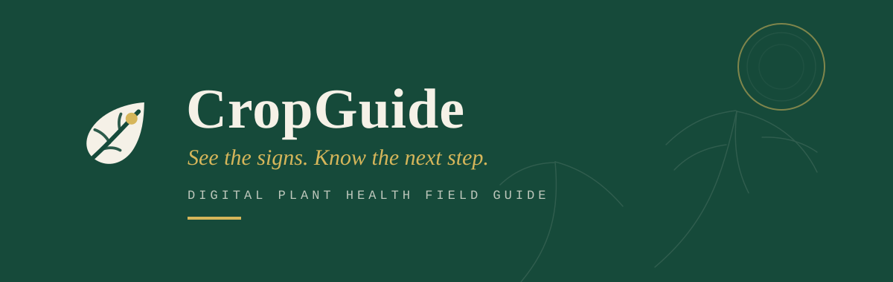
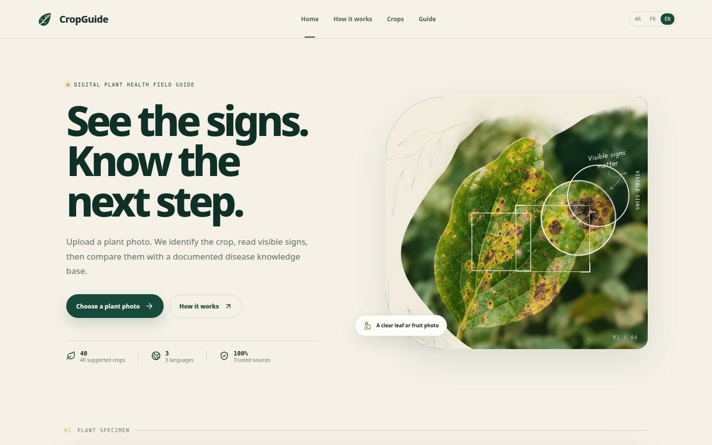
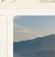
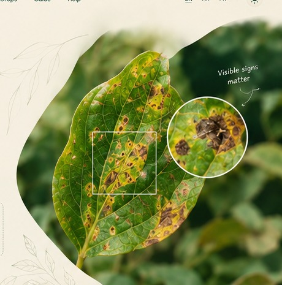

<p align="center">
  
</p>

<p align="center">
  
  
  
  
</p>

**CropGuide** is a plant-health field guide. You take a photo of a sick leaf or fruit, and the app tells you what the visible signs could mean. It is a first check, not a final answer.

> The app is live and working. This is not an idea anymore.

<p align="center">
  
</p>

## What you can do

- Take a photo with your phone (JPEG, PNG or WebP, up to 7 MB)
- See the plant name and how sure the app is
- See up to 3 possible diseases, with the visible signs that support each one
- Read everything in 3 languages: Arabic, French, English
- Read what to check in the field before you use any product

## How it works

1. **Find the plant** — the app uses Plant.id to find the plant name. It checks 10 answers and says "I don't know" if it is not sure.
2. **Read the signs** — an AI looks at the photo and picks signs from a small list (like `yellow_halo` or `leaf_spot`). It does not guess the disease directly.
3. **Compare the evidence** — the app searches a documented disease knowledge base and shows the best matches. If the signs are not clear enough, it shows no answer. **No answer is better than a wrong answer.**

## Example

1. You take a photo of a tomato leaf with brown spots
2. The app says: "This looks like Tomato — 84% sure"
3. The app shows: "Early Blight — limited signs" + what to check in the field

## Coverage

**40 crops and 439 diseases** — olive, date palm, citrus, almond, fig, grape, tomato, potato, wheat, barley and 30 more.

Full list: [`data/coverage.md`](data/coverage.md)

| | | |
|:---:|:---:|:---:|
| <br/>**Tomato**<br/>*Solanum lycopersicum* | <br/>**Potato**<br/>*Solanum tuberosum* | <br/>**Olive**<br/>*Olea europaea* |
| <br/>**Wheat**<br/>*Triticum aestivum* | <br/>**Pepper**<br/>*Capsicum annuum* | <br/>**Cucumber**<br/>*Cucumis sativus* |

## Try it on your computer

You need Node.js 22, pnpm and Python 3.

```bash
pnpm install
pnpm dev
```

Open http://localhost:3000

To make it ready for the web:

```bash
pnpm build
pnpm start
```

You need two keys to make the photo check work: `PLANT_ID_API_KEY` and `BUILT_IN_FORGE_API_KEY`.

## Tech

- Node.js + Express (server)
- React + Vite (the app you see)
- SQLite (small database)
- Python (to build the database)
- Plant.id + Gemini (to read the photo)

Tests: `pnpm test` — they check that the code works. They do not check if the disease answer is always right.

## Important

- The app looks at one photo only.
- It shows **possible** answers, not a sure answer.
- Do not buy or use a product because the app says so.
- Always ask a local agriculture expert before you do anything.

## History

Old versions are saved as git tags. To see an old version:

```bash
git tag              # see all versions
git checkout v0.3    # go to version 0.3
git checkout master  # come back
```

| Version | Tag | What is new |
|---|---|---|
| 0.1 | — | First app that works |
| 0.2 | — | 7 crops, 3 languages |
| 0.3 | `v0.3` | More data |
| 0.4 | `v0.4` | Better details |
| 0.5 | `v0.5` | Better ranking |
| 0.6 | `v0.6` | Better for bad photos |
| 0.7 | `v0.7` | Checks for image size, tries again if needed |
| **0.8** | **`v0.8`** | **Now: better groups for common signs, better plant check** |

## License

MIT
